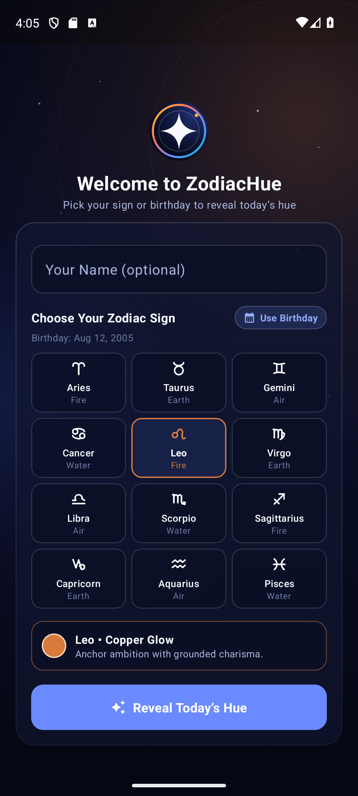
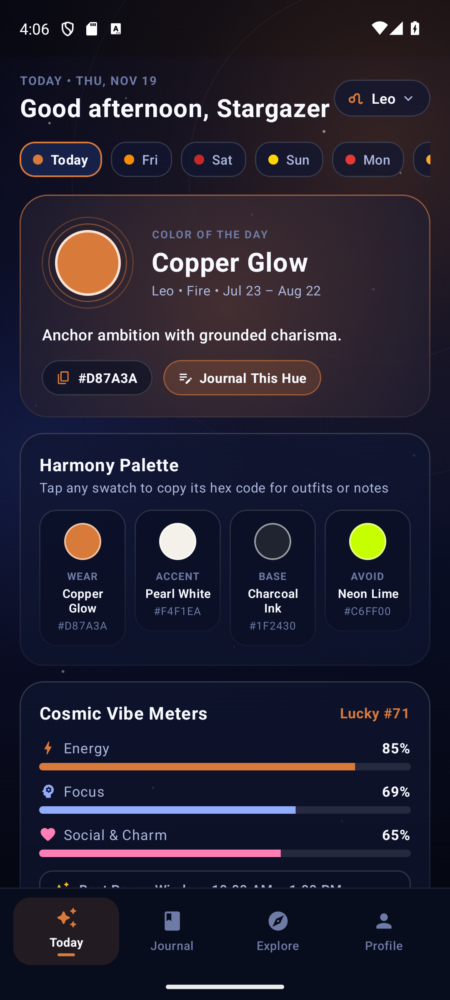
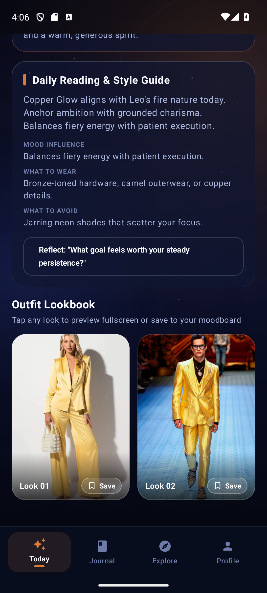
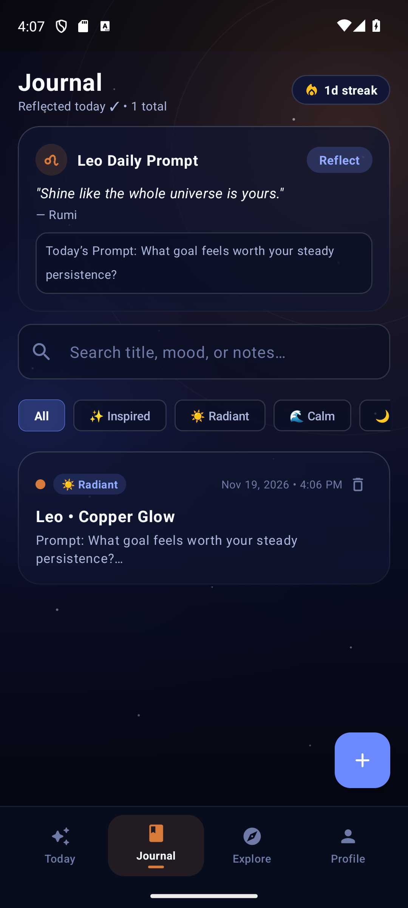
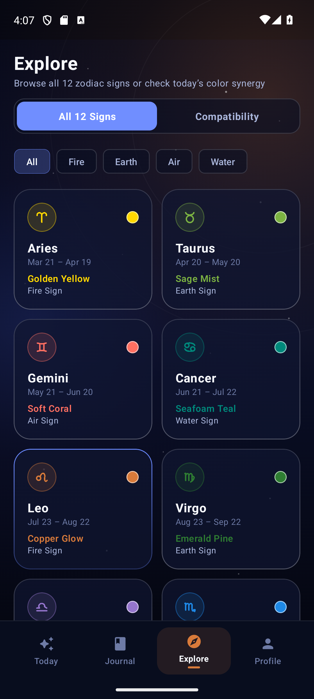
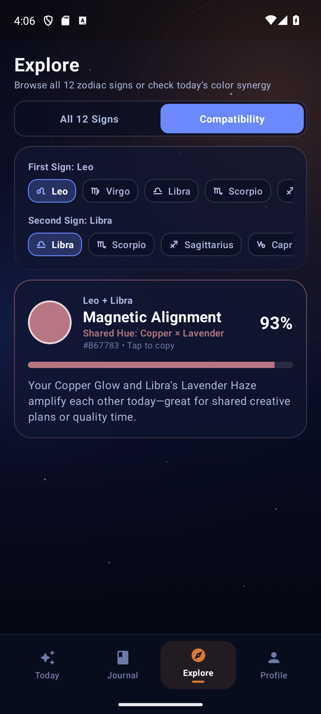
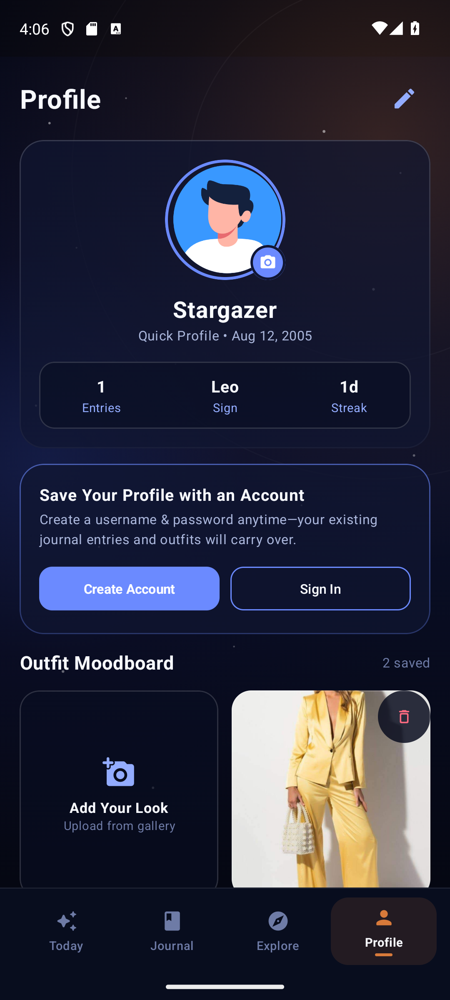

# ZodiacHue

A modern **Jetpack Compose + Material 3** Android app that pairs daily rotating zodiac **Colors of the Day** and outfit harmony palettes with a guided reflection journal.

## Preview

| Onboarding | Today's Hue & Vibe Meters | Style Guide & Lookbook | Guided Journal |
| :---: | :---: | :---: | :---: |
|  |  |  |  |

| All 12 Signs | Daily Compatibility | Profile & Moodboard |
| :---: | :---: | :---: |
|  |  |  |

## Features
- **Instant Onboarding & Optional Accounts**: Pick your zodiac sign or birthday to start right away, or create/sign in to an account anytime (carrying forward guest entries and saved looks).
- **Daily Hue & 7-Day Forecast**: Daily rotating colors per sign, 4-swatch **Harmony Palette** (Wear, Accent, Base, Avoid) with tap-to-copy hex codes, animated **Cosmic Vibe Meters** (Energy, Focus, Social), lucky number, power window, and outfit inspirations.
- **Guided Journal**: Streak tracking, daily reflection prompts, mood filters, live search, sharing, and undoable delete.
- **Explore & Compatibility**: Browse all 12 signs by element and check daily color synergy between any two signs.
- **Profile & Moodboard**: Save curated outfit looks or upload your own gallery photos, edit your profile/birthday, and manage your account.

## Tech Stack
Kotlin · Jetpack Compose · Material 3 · SharedPreferences + Gson

## Build & Test
```bash
./gradlew testDebugUnitTest assembleDebug
```
